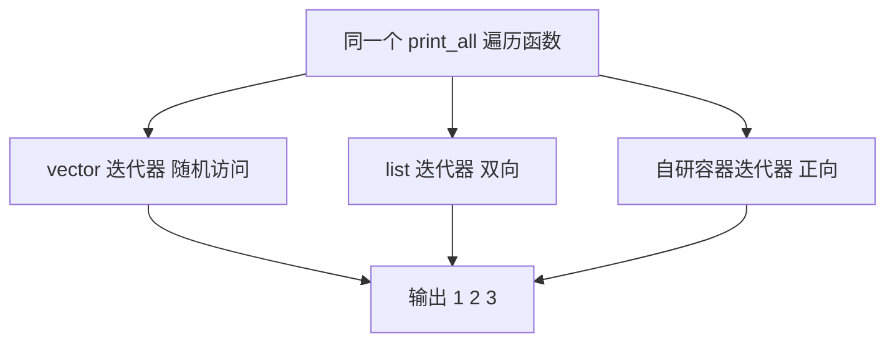
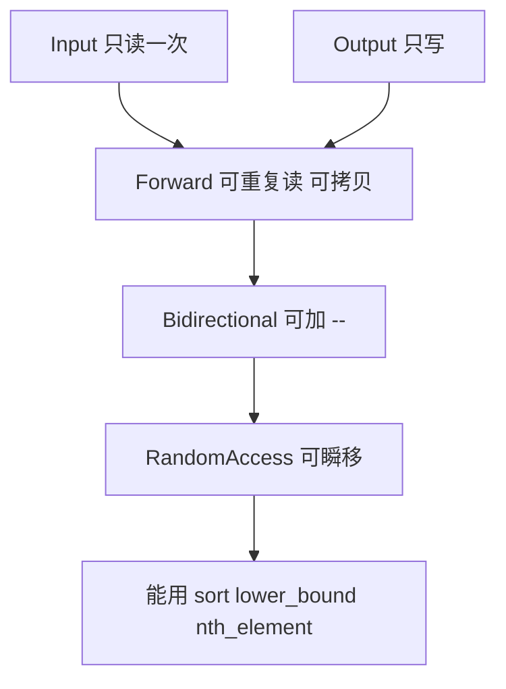
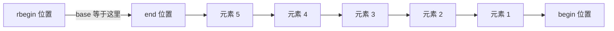
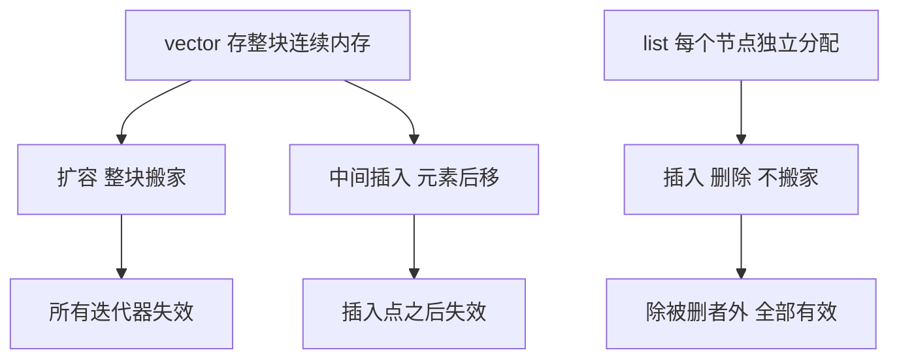
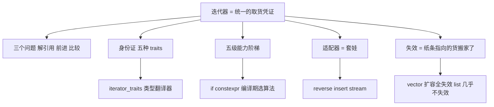

# 迭代器学习笔记 · 费曼学习法总结

> 对应练习文件：[`Phase1/01_iterator/iterator_exercises.hpp`](iterator_exercises.hpp)（共 2190 行，七个部分）
>
> 本文用「费曼学习法」组织：**先讲大白话 + 类比 → 再看代码 → 最后用检验问题自测**。
> 凡是出现术语（traits、适配器、哨兵节点、迭代器失效……）都会当场用大白话解释一次。

---

## 0. 为什么需要迭代器

### 一句话核心思想

> **迭代器就是把「访问第几个元素」这件事，从「怎么存数据」中剥离出来的一种统一说法。**

大白话：容器内部怎么存数据（连续内存？一个个节点？）是容器自己的事；外面的人只想说「给我第 0 个、第 1 个、第 2 个……」。
迭代器就是容器递给外面的一张「取货凭证」，凭这张凭证，你可以一个一个地把元素取出来，而不用知道仓库是货架式的还是抽屉式的。

类比：

- 容器 = 仓库
- 迭代器 = 取货小票（上面写着「下一个货位在哪」）
- 算法（`std::sort`、`std::copy`）= 不管仓库长什么样的搬运工

### 例子：同一份遍历代码适配 vector / list / 自研容器

```cpp
#include <vector>
#include <list>

// 一份遍历代码，三种容器都能用
template<typename Container>
void print_all(const Container& c){
    for(auto it = c.begin(); it != c.end(); ++it){
        std::cout << *it << ' ';
    }
    std::cout << '\n';
}

int main(){
    std::vector<int> v{1,2,3};      // 底层是连续内存
    std::list<int>   l{1,2,3};      // 底层是一个个独立节点
    print_all(v);                    // 1 2 3
    print_all(l);                    // 1 2 3
}
```

同一份 `print_all` 一次都没改。原因：`vector` 的迭代器是「随机访问」级别（能一步跳 3 格），
`list` 的迭代器是「双向」级别（只能一格一格挪），但**两者都至少支持 `++` 和 `==`**，
而 `print_all` 恰好只用到了这两样。算法和迭代器之间因此有了一份「最低公约数」协议。

本笔记第二部分会讲清楚：能力越强的迭代器，能解锁的算法越多，性能也越好。



---

## 第零课：迭代器三件套与「身份证」

### 0.1 「问三个问题」模型

面对任何一个迭代器，只问三个问题就能把它用起来：

| 问题 | 写法 | 大白话 | 类比 |
|---|---|---|---|
| 我指着啥 | `*it` | 解引用，拿出它指向的那个东西 | 小票上写的货位，取货 |
| 下一个是谁 | `++it` | 前进一格 | 走到下一个货架 |
| 同一个吗 | `it == other` | 比较是否指向同一位置 | 比对两张小票的货位号 |

```cpp
std::vector<int> v{10, 20, 30};
auto it = v.begin();
std::cout << *it;        // 10   —— 我指着啥
++it;                     //       下一个是谁
std::cout << *it;        // 20
std::cout << (it == v.begin());  // 0 —— 同一个吗
```

> **注意**：`end()` 指向「最后一个元素之后的位置」，它是一个合法的「位置」，但不能解引用。
> 这是所有迭代器循环的标准写法 `for(it = begin; it != end; ++it)` 的由来。

### 0.2 五行 `using`：迭代器的「身份证」

大白话：算法要写通用代码，就得先问「你这个迭代器能干什么、指向什么类型」。
标准库不可能去猜，所以约定：**每个迭代器类里必须公开五个类型别名**，
这就是「身份证」。算法拿身份证一对照，就知道该怎么用这个迭代器。

在 [`ForwardIterator`](iterator_exercises.hpp:273) 里：

```cpp
using iterator_category = std::forward_iterator_tag;              // 身份证: 我是什么级别
using value_type        = typename std::remove_const<T>::type;    // 身份证: 元素是什么类型
using difference_type   = std::ptrdiff_t;                         // 身份证: 距离用什么类型表示
using pointer           = T*;                                     // 身份证: 元素的指针类型
using reference          = T&;                                     // 身份证: 元素的引用类型
```

| 别名 | 含义（大白话） | 典型值 |
|---|---|---|
| `iterator_category` | 我的能力等级，决定能解锁哪些算法 | `std::random_access_iterator_tag` |
| `value_type` | 我指向的元素是什么类型（去掉 const） | `int` |
| `difference_type` | 「两个我差多远」这个数字用什么类型 | `std::ptrdiff_t` |
| `pointer` | 指向元素的指针类型 | `T*` |
| `reference` | 指向元素的引用类型 | `T&` |

这五个别名合起来就是 **`std::iterator_traits`** 认识一个迭代器的全部依据。
第四部分会详细讲。

### 0.3 为什么 `value_type` 要写 `typename std::remove_const<T>::type`

```cpp
using value_type = typename std::remove_const<T>::type;
```

大白话：`T` 可能是 `const int`，也可能是 `int`。但**元素类型本身是不变的**——
一个 `const int` 元素的「类型」就是 `int`，`const` 只是「这个盒子上了锁」。

类比：`const int` 是一只上了锁的盒子，盒子里装的东西还是 `int`。
`value_type` 描述的是「盒子里装什么」，所以要把锁去掉。

为什么要去掉？因为 `std::iterator_traits` 的 `value_type` 语义是「非 const 的元素类型」。
如果不去掉，`ForwardIterator<const int>` 的 `value_type` 会是 `const int`，
和标准库其它迭代器（如 `vector<int>::const_iterator`）的约定不一致，
`std::is_same` 检查就会失败。

`std::remove_const<T>::type` 就是「把锁去掉」的那个工具：输入 `const int`，输出 `int`。

### 0.4 为什么模板里必须写 `typename`

```cpp
using value_type = typename std::remove_const<T>::type;
//                             ^^^^^^^^^ 这是 dependent name
```

大白话：C++ 编译器是**一行一行**读代码的，读到这一行时 `T` 还没被替换成具体类型
（比如 `int`），所以它看到 `std::remove_const<T>::type` 这个写法时，
**分不清 `::type` 后面跟的是一个「类型名」还是一个「静态成员变量」**。

类比：就像收到一封没填具体地址的信，邮递员不知道该按「街道」投递还是按「门牌号」投递。
`typename` 就是你提前在信封上注明「这是类型名」。

规则记忆：

- 凡是 `某个依赖类型<T>::成员` 这种形式出现在模板里，`::` 后面跟的东西是**类型** → 写 `typename`
- 如果是**值**（静态数据成员、枚举） → 不能写 `typename`

### 0.5 `explicit` 的作用

```cpp
explicit ForwardIterator(T* p = nullptr) : ptr_(p) {}
```

大白话：加上 `explicit` 后，**不能**用 `=` 或者函数参数传参的方式隐式构造这个迭代器，
必须老老实实写 `ForwardIterator<int> it(arr);`。

不加 `explicit` 的话，下面这种危险的隐式转换会被允许：

```cpp
void foo(ForwardIterator<int> it);
int arr[3];
foo(arr);   // 不加 explicit 时会偷偷把 int* 转成迭代器，语义完全不是你想的
```

类比：`explicit` 就是「必须明说『我要造一个迭代器』」，不允许「顺便就变成了」。

### 0.6 `operator*` 后面的 `const` 到底约束了什么

```cpp
reference operator*() const { return *ptr_; }   // ForwardIterator
//     ^^^^^^^^^^^^^^^ 这个 const 在函数末尾
```

**大白话：这个末尾的 `const` 只约束「不改变迭代器自身状态」，不约束返回值的常量性。**

也就是说：

- 函数体里不能修改 `ptr_`（不能偷偷移动迭代器）；
- 但返回的 `reference` 是什么类型，跟这个 `const` **毫无关系**。

所以：

```cpp
using It = ForwardIterator<int>;
static_assert(std::is_same_v<decltype(*std::declval<It&>()), int&>);  // 返回 int&，可以改
*it = 42;   // 合法：*it 是 int&，可以赋值
```

如果你想「只读」，那要靠**类型本身带 const** 来控制：

```cpp
ForwardIterator<const int> cit(arr);   // T = const int
// 此时 reference = const int&，*cit = 42 就编译不过
```

类比：

- 末尾 `const` = 「这个店员只能给你指路，不能替你把货架搬走」（不改迭代器状态）
- `T` 里的 `const` = 「他指的那个货架上的货，本身是锁着的」（返回值只读）

**复述检验**：为什么 `ForwardIterator<const int>` 迭代器不能改元素，但 `ForwardIterator<int>` 的 `operator*` 末尾带着 `const` 却可以改？

---

## 第一部分：迭代器基础（练习 1.1 ~ 1.3）

### 1.1 四种遍历写法：等价性与差异

在 [`traverse_4()`](iterator_exercises.hpp:87) 里四种写法遍历同一个 `std::vector<Point>`：

```cpp
// 写法 1：下标 for
for(int i = 0; i < px.size(); ++i){ ... px[i].x ... }

// 写法 2：显式 iterator
for(std::vector<Point>::iterator it = px.begin(); it != px.end(); ++it){ ... (*it).x ... }

// 写法 3：auto
for(auto it = px.begin(); it != px.end(); ++it){ ... (*it).x ... }

// 写法 4：range-for
for(auto it : px){ ... it.x ... }
```

| 写法 | 能不能用于所有容器 | 能不能拿到下标 | 能不能改元素 | 典型用途 |
|---|---|---|---|---|
| 1 下标 | ❌ 只有支持 `operator[]` 的容器 | ✅ | ✅ | 需要下标运算 |
| 2 显式 iterator | ✅ 全部 | ❌ | ✅ | 需要手动控制循环逻辑 |
| 3 auto iterator | ✅ 全部 | ❌ | ✅ | 写法 2 的简写，最常用 |
| 4 range-for | ✅ 全部 | ❌ | ✅（`auto&` 时） | 只遍历不做别的 |

关键差异：

- 写法 1 把「容器必须支持 `operator[]`」写死了，`std::list` 就没有 `[]`，用不了。
- 写法 4（range-for）编译后**等价于**写法 3：`for(auto it = px.begin(); it != px.end(); ++it)`，
  只是编译器帮你写好了。range-for 里写 `auto it` 是**拷贝**，`auto& it` 是**引用**（不拷贝）。
- 写法 2/3/4 都不能拿到下标。要下标就用 `std::distance(begin, it)`（随机访问时是 O(1)）。

### 1.2 `*it` 返回引用 → 可以改元素；`it->m` 的实现原理

在 [`exercise_1_2_modify_by_iterator()`](iterator_exercises.hpp:128) 里：

```cpp
for(std::vector<uint16_t>::iterator x1_2 = vint.begin(); x1_2 != vint.end(); ++x1_2){
    *x1_2 = ab * 3;      // 能改，因为 * 返回引用
}
```

**为什么能改？** 因为 `operator*` 的返回类型是 `reference`，也就是 `T&`：

```cpp
T& operator*() const { return *ptr_; }   // 返回的是元素本身的引用，不是拷贝
```

如果写成 `T operator*() const { return *ptr_; }`（按值返回），那 `*it = 42` 改的就是**临时副本**，
容器里的元素纹丝不动 —— 这是新手最常见的 bug。

**`it->m` 的原理**：箭头运算符 `->` 就是 `(*it).m` 的语法糖。
标准库里的实现是：

```cpp
T* operator->() const { return ptr_; }
```

编译器遇到 `it->x` 时，会展开成 `it.operator->()->x`，也就是 `ptr_->x`。
所以 `operator->` 返回**指针**（不是引用）。对照 [`exercise_1_2` 里的用法](iterator_exercises.hpp:156)：

```cpp
x1_2->x = 1;      // 等价于 (*x1_2).x = 1
x1_2->y = 1;
```

类比：`it` 是一张写着门牌号的小票，`*it` 是「按小票取到东西本身」，`it->m` 是「按小票取到东西，再拿它的成员 m」。
后者的实现就是「先把小票换算成地址，再去取成员」。

### 1.3 `const_iterator`：`cbegin()/cend()`

大白话：`iterator` 给你「可读可写」的取货小票；`const_iterator` 给的是「只读小票」。

| | 非 const 容器 | const 容器 |
|---|---|---|
| `begin()` | 返回 `iterator` | 返回 `const_iterator` |
| `cbegin()` | 返回 `const_iterator` | 返回 `const_iterator` |

在 [`exercise_1_3_const_iterator()`](iterator_exercises.hpp:191) 里验证：

```cpp
std::vector<int> mv{1, 2, 3};
using It  = decltype(mv.begin());     // iterator
using CIt = decltype(mv.cbegin());    // const_iterator
bool same_type = std::is_same<It, CIt>::value;   // false
```

- `decltype(表达式)` = 「这个表达式的类型是什么」，编译器原样报给你。
- `std::is_same<A, B>::value` = 编译期常量，A 和 B 是同一个类型就是 `true`。

所以对**非 const 容器**：`begin()` 和 `cbegin()` **不是同一个类型**；
但对 **const 容器**：`begin()` 和 `cbegin()` **是同一个类型**（都是 `const_iterator`），
因为 const 容器根本不允许修改元素，只能给只读小票。

另外注意 `const_iterator` 的 `operator*` 返回 `const int&`，
所以 `*it = 100` 是**编译期错误**（见源码注释），不是运行期错误。

### 1.4 区间语义：`std::copy(v.begin(), v.end(), dst.begin())`

在 [`exercise_1_2` 末尾](iterator_exercises.hpp:176)：

```cpp
std::vector<int> v{1,5,3,7,6};
std::vector<int> dst(5);
std::copy(v.begin(), v.end(), dst.begin());
```

**区间语义 = 左闭右开 `[begin, end)`。**
`end()` 是「最后一个元素的下一个位置」，**不包含在区间里**。

大白话：`[begin, end)` 像念书时「从第 1 页念到第 9 页的前一页」，共 8 页。
`end` 是「第 9 页本身」，不念。

好处：

- 空容器天然正确：`begin() == end()`，区间长度为 0，不需要任何特判。
- 拼接区间很容易：`[v.begin(), v.begin()+3)` 和 `[v.begin()+3, v.end())` 合起来就是整个 vector。

`std::copy` 的第三个参数是**输出位置**，所以 `dst` 必须已经开好空间（这里 `dst(5)` 预分配了 5 个）。
如果目标容器大小不确定，就用第三部分的插入迭代器 `back_inserter`。

**复述检验**：`std::copy(v.begin(), v.end(), dst.begin())` 中，`end()` 指向的那个位置会被拷贝吗？`dst` 的大小应该怎么定？

---

## 第二部分：迭代器类别（练习 2.1 ~ 2.3）

### 2.1 五级能力阶梯

大白话：迭代器按「能走多远、能倒退吗、能不能一步跳」分成五个等级。
**越往下能力越多，能用的算法越多，速度也越快。**

| 级别 | 标签 | 支持的核心运算 | 典型容器 | 复杂度 |
|---|---|---|---|---|
| 1 | `input_iterator_tag` | `*`、`++`、`==`、`!=`（只读一次） | `istream_iterator` | 只进不退 |
| 2 | `output_iterator_tag` | `*`（写）、`++` | `ostream_iterator`、`back_inserter` | 只进不退 |
| 3 | `forward_iterator_tag` | 输入 + 可反复读、可拷贝 | `forward_list`、本文件的 `ForwardIterator` | 只进不退 |
| 4 | `bidirectional_iterator_tag` | forward + `--` | `list`、`map`、`set` | 可进可退 |
| 5 | `random_access_iterator_tag` | bidirectional + `+ - += -= [] < > <= >=` | `vector`、`deque`、`array`、原生指针 | 可瞬移 |

类比：像爬楼梯。

- **Input**：只能一层一层往上爬，看过的不能再回头看（读了就没了）。
- **Output**：只能往上爬，而且你是「往上写东西」的人（不是取货）。
- **Forward**：能一直往上爬，每一层可以反复看。
- **Bidirectional**：还能往下爬。
- **RandomAccess**：可以直接说「我要第 37 层」，一步到位。



**「越往下能力越多，算法解锁越多」**：

- `std::copy`、`std::for_each` → 只需要 Input。
- `std::fill`、`std::transform` → Output。
- `std::sort`、`std::find`、`std::reverse`、`std::unique` → 至少 Forward。
- `std::reverse` 反向用法、`std::prev`、`std::distance` 负数 → 至少 Bidirectional。
- `std::sort`、`std::lower_bound`、`std::binary_search`、`std::nth_element` → 必须 RandomAccess。

### 2.2 ForwardIterator：只能 `++`

在 [`ForwardIterator`](iterator_exercises.hpp:273) 里实现了正向迭代器：

```cpp
template<typename T>
class ForwardIterator{
public:
    using iterator_category = std::forward_iterator_tag;
    using value_type        = typename std::remove_const<T>::type;
    using difference_type   = std::ptrdiff_t;
    using pointer           = T*;
    using reference          = T&;

    explicit ForwardIterator(T* p = nullptr) : ptr_(p) {}

    T& operator*() const {return *ptr_;}
    T* operator->() const {return ptr_;}

    ForwardIterator& operator++(){ ++ptr_; return *this; }        // 前置: 返回自身引用
    ForwardIterator operator++(int){ ForwardIterator tmp(*this); ++ptr_; return tmp; }  // 后置: 返回旧值拷贝

    bool operator==(const ForwardIterator& rhs) const { return ptr_ == rhs.ptr_; }
    bool operator!=(const ForwardIterator& rhs) const { return ptr_ != rhs.ptr_; }
private:
    T* ptr_;
};
```

大白话：这是一个「只能前进、不能后退」的取货员。他没有 `--`，你也没法让他跳着走。

**前置 `++` 与后置 `++` 的区别**：

| | 返回什么 | 用在哪 |
|---|---|---|
| `++it`（前置） | `ForwardIterator&`（自身引用） | 链式赋值 `it = ++it`、循环里最常用 |
| `it++`（后置） | `ForwardIterator`（旧值拷贝） | 需要「旧位置」时，如 `auto old = it++;` |

后置 `++` **必须返回按值**，绝不能返回引用，否则 `auto& old = it++;` 会拿到一个随 `it` 一起变的引用，
语义完全错乱（这是一个经典坑，见文末「常见坑清单」）。

### 2.3 BidirectionalIterator：加 `--`

在 [`BidirectionalIterator`](iterator_exercises.hpp:354) 里，在 Forward 基础上只多了两件事：

```cpp
BidirectionalIterator& operator--(){
    --ptr_;
    return *this;
}
BidirectionalIterator operator--(int){
    BidirectionalIterator tmp(*this);
    --ptr_;
    return tmp;
}
```

另一个练习实现 [`ImatateIterator`](iterator_exercises.hpp:398)（模仿/仿写版本），
能力完全一样：能 `++` 也能 `--`。

**反向遍历的标准写法**：`--it; it != begin`（先退一步，再判断）

```cpp
// 在 exercise_2_2_bidirectional_iterator() 里
int arr[] = {1, 2, 3, 4, 5};
ImatateIterator<int> it(arr + 5);      // 先指向末尾之后
ImatateIterator<int> itBegin(arr);     // 起点

for(--it; it != itBegin; --it){        // 先 -- 再判断
    SHOWE(*it);
}
```

大白话：迭代器初始在 `end()`（末尾之后），`end()` 不能解引用，
所以**先 `--` 退到最后一个有效元素**，之后每次循环体结束再 `--`。

类比：指针指向「最后一排之后的位置」，你先往前挪一步站到最后一排，才能开始数。

### 2.4 RandomAccessIterator：能瞬移

在 [`RandomAccessIterator`](iterator_exercises.hpp:499) 里。

大白话：前面几级迭代器是「一格一格挪」，随机访问迭代器是「说一个数，直接站到那格」。
它内部其实还是指针，所以实现全部靠指针算术。

#### (1) `+=`（原地改自己）与 `+`（产出新对象）的区别

```cpp
// 复合赋值: 原地修改自己, 返回自身引用
RandomAccessIterator& operator+=(difference_type n){
    ptr_ += n;
    return *this;
}

// 二元 +: 产出新对象, 原对象不变
RandomAccessIterator operator+(difference_type n) const {
    return RandomAccessIterator(ptr_ + n);
}
```

| | `it += 3` | `it + 3` |
|---|---|---|
| `it` 本身 | **变了** | **不变** |
| 返回 | `it` 的引用 | 一个新的迭代器 |
| 典型用法 | 循环里推进指针 | 取某个位置的副本去访问 |

类比：
- `it += 3` = 「你往前走 3 步」（人本身移动了）
- `it + 3` = 「你往前走 3 步的**那个位置**」（给你一份坐标记录，人还在原地）

#### (2) `friend` 自由函数实现 `n + it` 对称形式

```cpp
// 二元 +: 迭代器 + 偏移
RandomAccessIterator operator+(difference_type n) const {
    return RandomAccessIterator(ptr_ + n);
}
// 二元 +: 偏移 + 迭代器 (非成员形式, 通过友元实现对称)
friend RandomAccessIterator operator+(difference_type n, const RandomAccessIterator& it){
    return RandomAccessIterator(it.ptr_ + n);
}
```

为什么需要友元？因为 `n + it` 里，`n` 是整数，`it` 是迭代器，
**运算符左边是整数**，此时成员函数 `operator+` 根本不会被考虑（成员函数形式要求左边是 `*this` 所属类）。
所以只能写成**自由函数**。

那自由函数怎么访问 `it.ptr_`（private）？两种办法：
1. 写成 `friend`，让它成为类的「自己人」（本文件采用）；
2. 写成**非成员**但用 `it + n` 转调成员函数（`operator+(n, it)` 里写 `return it + n;`）。

用友元的理由：**对称**。`it + n` 和 `n + it` 都得能写，两者实现几乎一样，
写成友元可以直接访问私有成员，代码最直白。

标准库里的写法就是模板 + 友元：

```cpp
template<typename Iter>
Iter operator+(typename Iter::difference_type n, const Iter& it){
    return it + n;
}
```

#### (3) `operator-` 的「双重人格」

这是本文件里最值得反复看的一段。在 [`RandomAccessIterator`](iterator_exercises.hpp:552)：

```cpp
// 二元 -: 迭代器 - 偏移  -> 返回迭代器
RandomAccessIterator operator-(difference_type n) const {
    return RandomAccessIterator(ptr_ - n);
}
// 二元 -: 迭代器 - 迭代器 -> 返回距离 (ptrdiff_t)
difference_type operator-(const RandomAccessIterator& rhs) const {
    return ptr_ - rhs.ptr_;
}
```

**同一个 `operator-`，靠「参数类型」区分两种完全不同的语义：**

| 写法 | 参数 | 返回 | 含义 |
|---|---|---|---|
| `it - n` | 整数 `n` | **迭代器** | 往回退 n 步的那个位置 |
| `itEnd - it` | 另一个迭代器 | **`ptrdiff_t`（数字）** | 两个位置相差多少步 |

为什么能这样？因为 C++ 的函数重载就是「按参数类型挑函数」。
传整数就选中第一个，传迭代器就选中第二个。

类比：`减号` 在不同语境下含义不同——「从第 10 层退 3 层」（得到第 7 层，一个位置）
和「第 10 层和第 7 层差几层」（得到 3，一个数字）。
参数类型不同，编译器自动挑对应的实现。

> **坑**：如果你只写 `difference_type operator-(difference_type n)` 而不写「迭代器减迭代器」版本，
> `itEnd - it` 就没法算距离，`std::distance` 只能退化成 O(n) 循环；反之只写迭代器版本，
> `it - 3` 就编译不过。

#### (4) `operator[]` 为什么是 `std::sort` 的关键

```cpp
reference operator[]](difference_type n) const { return ptr_[n]; }
```

大白话：`it[3]` 就是「从 `it` 出发数 3 格的那个元素」。

标准库的 `std::sort` 内部用的是**快速排序 / 插半排序**，需要做「取中间元素」「交换两个位置」这类操作。
有了 `operator[]` 和 `+`/`-`，sort 才能在 O(1) 时间内随机访问任意位置，
整体做到 O(n log n)。

如果没有 `operator[]`，`std::sort` 就没法用（标准规定 `std::sort` 要求 RandomAccessIterator）。
没有 `+`/`-`，`std::nth_element`、`std::lower_bound` 这类二分算法也用不了。

类比：`operator[]` 就像给仓库发号牌，「3 号货架的东西给我」，
而不是「从 1 号开始一格一格走到 3 号」——后者在 1000 个货位时慢得多。

#### (5) 六个比较运算符补齐后，`sort` 才能判断谁在前

```cpp
bool operator==(const RandomAccessIterator& rhs) const { return ptr_ == rhs.ptr_; }
bool operator!=(const RandomAccessIterator& rhs) const { return ptr_ != rhs.ptr_; }
bool operator< (const RandomAccessIterator& rhs) const { return ptr_ <  rhs.ptr_; }
bool operator<=(const RandomAccessIterator& rhs) const { return ptr_ <= rhs.ptr_; }
bool operator> (const RandomAccessIterator& rhs) const { return ptr_ >  rhs.ptr_; }
bool operator>=(const RandomAccessIterator& rhs) const { return ptr_ >= rhs.ptr_; }
```

大白话：`==`/`!=` 回答「是不是同一个」，`<`/`<=`/`>`/`>=` 回答「谁在前面」。
`std::sort` 内部需要不断问「这两个元素谁小」，所以必须提供 `<`（以及 `<=`）。

> 注意 `<` 的语义是**位置比较**（`ptr_ < rhs.ptr_`），而 `std::sort` 是按**元素值**排序，
> 两者不要混淆：迭代器的 `<` 只在「比较两个迭代器的位置」时用。

### 2.5 能力对照表

| 运算 | Forward | Bidirectional | RandomAccess |
|---|---|---|---|
| `*it` | ✅ | ✅ | ✅ |
| `it->m` | ✅ | ✅ | ✅ |
| `++it` / `it++` | ✅ | ✅ | ✅ |
| `--it` / `it--` | ❌ | ✅ | ✅ |
| `it == other` / `!=` | ✅ | ✅ | ✅ |
| `it + n` / `n + it` | ❌ | ❌ | ✅ |
| `it - n` | ❌ | ❌ | ✅ |
| `it - other`（距离） | ❌ | ❌ | ✅ |
| `it += n` / `-= n` | ❌ | ❌ | ✅ |
| `it[n]` | ❌ | ❌ | ✅ |
| `< <= > >=` | ❌ | ❌ | ✅ |
| `std::copy` | ✅ | ✅ | ✅ |
| `std::find` / `std::reverse` | ✅ | ✅ | ✅ |
| `std::sort` | ❌ | ❌ | ✅ |
| `std::lower_bound` | ❌ | ❌ | ✅ |
| `std::distance` 复杂度 | O(n) | O(n) | **O(1)** |

### 2.6 ⚠️ 提醒：Forward 版本没有 `operator<`

严格按标准，`ForwardIterator` 的要求里包含 `operator==`、`operator!=`，
而 `reference` 必须是 `value_type&`（对 `ForwardIterator<const T>` 来说就是 `const T&`）——
本文件的 Forward 版本是满足的。但**它没有 `operator<`**，
这意味着它**不能**被称为「完整的 ForwardIterator + LegacyForwardIterator 全套比较运算符」，
用 `std::forward_list` 的某些算法（如需要比较位置的 `std::distance` 优化路径）时要留意。

更准确地说：
- 标准把**关系比较**（`<` 等）归在 **LegacyRandomAccessIterator** 的要求里，不在 Forward 的必需项中；
- 但 `std::sort` 之类的算法需要 RandomAccess，这没问题；
- 真正要注意的是：**不要给 Forward 迭代器滥用 `std::sort`**（它根本不接受）。

> 本文件实现的 `ForwardIterator` 是一个**教学简化版**：
> 少了 `operator--`（Forward 本来也不需要），少了 `postfix` 的 `const` 变体，
> 也没实现 `std::iterator` 继承（C++17 后已废弃该做法）。
> 作为练习够用，作为生产代码请直接用标准库容器。

**复述检验**：
1. `it += 3` 和 `it + 3` 有什么区别？哪个会改变 `it` 本身？
2. 为什么 `n + it` 必须写成自由函数而不能是成员函数？
3. `itEnd - it` 和 `it - 3` 分别返回什么？为什么能重载区分？

---

## 第三部分：迭代器适配器（练习 3.1 ~ 3.4）

### 3.1 适配器 = 「套娃」

大白话：**迭代器适配器（iterator adapter）就是一个「套娃」**：
它不修改原来的类，而是**把原来的迭代器包在自己里面**，然后对外提供一套新的（但意义不同的）接口。

- 组合（composition）代替继承（inheritance）：新类里存一个「被包装的迭代器」成员。
- 不改原类一行代码，就获得了新行为。

类比：
- 手机壳套在手机上，手机还是手机，但你现在有了一个「带壳的手机」，手感/接口可以不一样。
- 或者：套娃娃娃，里面那个还是原来那个，只是外面多了几层。

典型三种：

| 适配器 | 干什么 | 本文件位置 |
|---|---|---|
| `std::reverse_iterator` | 把正向遍历变成反向遍历 | [`exercise_3_1`](iterator_exercises.hpp:665) |
| 插入迭代器 | 把「写值」变成「插入元素」 | [`exercise_3_3`](iterator_exercises.hpp:828) |
| 流迭代器 | 把「读/写流」变成「遍历元素」 | [`exercise_3_4`](iterator_exercises.hpp:887) |

### 3.2 `std::reverse_iterator`

在 [`exercise_3_1_reverse_iterator()`](iterator_exercises.hpp:665)：

```cpp
std::vector<int> v{1, 2, 3, 4, 5};

for(auto rit = v.rbegin(); rit != v.rend(); ++rit){
    SHOWE(*rit);          // 5 4 3 2 1
}

auto rit = v.rbegin();
auto base = rit.base();
SHOWE(yes_no(base == v.end()));   // 是
```

**核心约定：`rbegin().base() == end()`。**

也就是说，反向迭代器内部保存的那个正向迭代器，
一开始停在「末尾之后」（`end()`），因此它比真正要访问的元素「领先一格」。



**反向的 `++` 实为底层的 `--`**：

```cpp
// reverse_iterator 的内部逻辑（标准库）
reference operator*() const {
    Iterator tmp = current;   // 拷贝
    return *--tmp;            // 先退一格再解引用
}
reference operator++() {
    --current;                // 反向 ++ 就是底层 --
    return *this;
}
```

所以在演示里能看到：

```cpp
++rit;                                   // 反向走一步
auto base2 = rit.base();
SHOWE(yes_no(base2 == (v.end() - 1)));   // 是
```

**`base()` 的用途：拆包取回正向迭代器。**
大白话：适配器是个套娃，`base()` 就是「把套娃打开，拿到里面那个原来的迭代器」。
当你需要一个真正的正向迭代器（比如去做 `std::lower_bound`）时，就靠它。

### 3.3 自写 `ReverseIterator`

在 [`ReverseIterator`](iterator_exercises.hpp:724)：

```cpp
template<typename Iterator>
class ReverseIterator{
public:
    using iterator_type    = Iterator;
    using iterator_category = typename std::iterator_traits<Iterator>::iterator_category;
    using value_type        = typename std::iterator_traits<Iterator>::value_type;
    using difference_type   = typename std::iterator_traits<Iterator>::difference_type;
    using pointer           = typename std::iterator_traits<Iterator>::pointer;
    using reference          = typename std::iterator_traits<Iterator>::reference;

    explicit ReverseIterator(Iterator it) : cur_(it) {}

    Iterator base() const { return cur_; }

    reference operator*() const {
        Iterator tmp = cur_;
        return *(--tmp);
    }

    pointer operator->() const {
        Iterator tmp = cur_;
        --tmp;
        return tmp.operator->();
    }

    ReverseIterator& operator++(){ --cur_; return *this; }   // 反向 ++ = 底层 --
    ReverseIterator& operator--(){ ++cur_; return *this; }   // 反向 -- = 底层 ++

    bool operator==(const ReverseIterator& rhs) const { return cur_ == rhs.cur_; }
    bool operator!=(const ReverseIterator& rhs) const { return cur_ != rhs.cur_; }

private:
    Iterator cur_;
};
```

#### (1) 核心约定：`cur_` 永远停在「当前元素的下一个」

这是整个实现的地基。大白话：

> 反向迭代器内部那个正向迭代器 `cur_`，**永远指向「我要访问的那个元素的下一个位置」**。

所以 `*it` 不能直接返回 `*cur_`（那会拿到下一个元素），
必须**先拷贝一份 tmp，再 `--tmp`，然后解引用 tmp**。

```cpp
reference operator*() const {
    Iterator tmp = cur_;     // 拷贝一份
    return *(--tmp);         // 副本退一格, 再取值
}
```

**为什么不能直接改 `cur_`？**
因为 `operator*` 是 `const` 成员函数，它承诺「不解引用不改变迭代器状态」。
如果直接 `--cur_`，那 `*it` 调用一次，迭代器就跑掉了 —— 语义完全错乱。

类比：`cur_` 是「你现在站的位置的前一格」。
要拿手里的东西，得**探头往回看一眼**（临时退半步），看完还得站回原处。

#### (2) 反向遍历区间是 `[rend, rit)`，起点用 `end()`、终点用 `begin()`

在 [`exercise_3_2_custom_reverse_iterator()`](iterator_exercises.hpp:780)：

```cpp
std::vector<int> v{1, 2, 3, 4, 5};

// 构造: 用 v.end() 构造, 语义与 std::reverse_iterator 一致
ReverseIterator<std::vector<int>::iterator> rit(v.end());    // 起点 = end()
ReverseIterator<std::vector<int>::iterator> rend(v.begin()); // 终点 = begin()

for(; rit != rend; ++rit){
    SHOWE(*rit);        // 5 4 3 2 1
}
```

大白话：
- **起点 `rit` 用 `v.end()` 构造** —— 因为 `cur_` 约定是「停在当前元素的下一个」，
  第一个要访问的元素是最后一个（`v[4]`），它的「下一个」正好是 `end()`。
- **终点 `rend` 用 `v.begin()` 构造** —— 因为 `cur_` 停在 `begin()` 时，
  它前面的那个元素是「不存在的第一个元素之前」，正好表示遍历结束。

所以反向区间是 **`[rend, rit)`**（左闭右开），起点和终点跟正向刚好**对调**。

#### (3) `base()` 的用途（拆包取回正向迭代器）

```cpp
Iterator base() const { return cur_; }
```

大白话：把套娃打开，拿到里面那个**正向**迭代器。
用途：把反向区间还原成正向区间去做别的算法；或者在反向遍历中定位「当前元素的前一个」。

```cpp
auto r0 = ReverseIterator<std::vector<int>::iterator>(v.end());
SHOWE(yes_no(r0.base() == v.end()));   // 是
```

#### (4) ⭐ 为什么这里的 `using` 声明和前面不一样

前面 `ForwardIterator` 的模板参数是**元素类型 `T`**：

```cpp
template<typename T>
class ForwardIterator{
    using value_type = typename std::remove_const<T>::type;   // 直接从 T 算
    ...
};
```

而 `ReverseIterator` 的模板参数变成了**一个迭代器 `Iterator`**：

```cpp
template<typename Iterator>
class ReverseIterator{
    using value_type = typename std::iterator_traits<Iterator>::value_type;
    ...
};
```

**为什么不一样？** 因为适配器是「套娃」：
它自己**根本不知道**元素是 `int` 还是 `Point` 还是 `Pose`。
它手里只有一个「套娃里的那个迭代器」。想知道元素类型，
只能**去翻那个迭代器的身份证**，也就是 `std::iterator_traits<Iterator>::value_type`。

大白话：套娃外面这层不知道里面装的是啥珠子，只能问里面的珠子「你是什么珠子」。

类比：`std::iterator_traits<Iterator>` 就是「**翻底层迭代器的身份证抄作业**」——
底层说是 `int`，那我也是 `int`；底层说是 `random_access`，那我也是 `random_access`。

另外多了一个 **`iterator_type`**：

```cpp
using iterator_type = Iterator;
```

它的作用是：**记录被包装的原始类型**，方便 `base()` 的返回类型推导、
以及让外层代码知道「我里面装的是哪种迭代器」。
标准库的 `std::reverse_iterator` 也有这个成员。

#### (5) `iterator_category` 必须**继承**底层

```cpp
using iterator_category = typename std::iterator_traits<Iterator>::iterator_category;
```

**大白话：适配器不能创造底层没有的能力。**

一个包装了 `list` 迭代器的反向迭代器，**依然是双向的**（因为 `list` 迭代器本身就是双向的）；
包装 `vector` 迭代器的反向迭代器，**依然是随机访问的**。

如果适配器擅自声明 `random_access_iterator_tag`，
但底层只有 `++`/`--`，那 `std::sort` 就会去调 `it + n`，直接编译报错或者运行出错。

类比：给一辆手动挡汽车装个自动挡外壳，它并不会因此多出四个轮子。

#### (6) `operator->` 里为什么写 `tmp.operator->()` 而不是 `tmp->m`

```cpp
pointer operator->() const {
    Iterator tmp = cur_;
    --tmp;
    return tmp.operator->();      // 注意这里
}
```

大白话：`tmp` 的类型是**模板参数 `Iterator`**，它此刻还没有被实例化成具体类型。
编译器在做语法检查时，**不知道 `Iterator` 到底支不支持 `->`**。

- 如果写 `tmp->m`：编译器看到 `->` 就去找 `operator->`，
  但 `Iterator` 是未实例化的依赖类型，**编译器无法确认这个 `operator->` 存在** → 报错。
- 写 `tmp.operator->()`：这是**显式的函数调用语法**，不依赖 `->` 运算符重载的查找，
  编译器在实例化 `Iterator`（比如 `std::vector<int>::iterator`）时就能确认它有 `operator->`。

> 更严格地说：对未实例化的依赖类型调用成员函数，
> 需要写成 `template` 形式 `tmp.template operator->()`（因为 `->` 后面可能被解析为
> 「依赖名的限定符」）。在 `Iterator` 是类模板参数、`tmp` 是该类型对象的情况下，
> `tmp.operator->()` 通常能通过，因为 `->` 后面跟的是普通标识符 `operator->`，
> 不需要 `template` 关键字。本文件这一行正是这样写的。

类比：`tmp` 是「一个还不知道具体型号的遥控器」。
你按「跳台」键（`->`），得先确认这台遥控器**有这个键**；
写成 `tmp.operator->()` 就是「明确地调用『跳台键』这个方法」，语义上更直白。

#### (7) ⚠️ 该实现**没有** `+` `-` `[]` `<`

看一遍 [`ReverseIterator`](iterator_exercises.hpp:724) 的成员列表：
只有 `base`、`*`、`->`、`++`、`--`、`==`、`!=`。

**所以它实际上只到 forward 级别**，但 `iterator_category` 却声明为「继承底层」
（底层若是 `vector<int>::iterator`，就是 `random_access_iterator_tag`），
**声明和实际能力不一致**——这是**教学简化**。

后果举例：

```cpp
ReverseIterator<std::vector<int>::iterator> r(v.end());
r + 1;             // 编译错误：没有 operator+
std::sort(r.begin(), r.end());  // 也不行
```

严格的 `std::reverse_iterator` **是**提供 `+ - [] <` 的（它继承底层能力）。
本文件为了突出「方向反转」这个核心，把这些都省略了。

> **重要提醒**：正因为声明了 `random_access_iterator_tag` 却没实现 `+`，
> 把这个自定义类型喂给需要随机访问的标准算法会**编译失败**。
> 这是本练习的已知简化点，不是「写错了」。

**复述检验**：
1. 为什么 `ReverseIterator` 的 `operator*` 要先拷贝 `tmp` 再 `--tmp`？能不能直接 `--cur_`？
2. 自写 `ReverseIterator` 的起点为什么用 `v.end()` 构造，而终点用 `v.begin()`？
3. 为什么它的 `value_type` 要从 `std::iterator_traits<Iterator>` 里抄？
4. 它的 `iterator_category` 为什么必须继承底层，不能自己声明一个更高的？

### 3.4 插入迭代器

在 [`exercise_3_3_insert_iterator()`](iterator_exercises.hpp:828)：

| 适配器 | 行为 | 结果顺序 |
|---|---|---|
| `std::back_inserter(v)` | 每次赋值都 `v.push_back(x)` | 与源顺序**一致** |
| `std::front_inserter(d)` | 每次赋值都 `d.push_front(x)` | 与源顺序**反转** |
| `std::inserter(v, pos)` | 每次赋值都在 `pos` 前面插入 | 插到指定位置 |

```cpp
std::vector<int> src{1, 2, 3, 4, 5};

// back_inserter: 在容器末尾插入
std::vector<int> v1;
std::copy(src.begin(), src.end(), std::back_inserter(v1));
// v1 == {1, 2, 3, 4, 5}

// front_inserter: 在容器开头插入 (注意顺序会反转)
std::deque<int> d;
std::copy(src.begin(), src.end(), std::front_inserter(d));
// d == {5, 4, 3, 2, 1}   <-- 反转！

// inserter: 在指定位置插入
std::vector<int> v2{100, 200};
auto ins = std::inserter(v2, v2.begin());
std::copy(src.begin(), src.end(), ins);
// v2 == {1, 2, 3, 4, 5, 100, 200}
```

**⚠️ `front_inserter` 顺序会反转 —— 这是最容易踩的坑。**

大白话：源序列是 1,2,3,4,5，`front_inserter` 每次都插到**最前面**，
所以 5 最后插，它在最前面；1 最先插，它跑到最后 → 结果 5,4,3,2,1。

类比：排队进电梯，每个人都「插队到最前面」，最后来的人反而站在最前面。

`back_inserter` 顺序不变，因为它每次都插到**最后面**，先来的自然先站。

**插入迭代器解决了什么问题？**
输出迭代器（如 `back_insert_iterator`）不需要事先知道目标容器有多大，
这是它相对「`operator[]` 输出位置」的最大优势。代价是**不能随机访问**，
所以它只是 Output 级别。

### 3.5 流迭代器

在 [`exercise_3_4_stream_iterator()`](iterator_exercises.hpp:887)：

| | 作用 |
|---|---|
| `std::istream_iterator<T>` | 从输入流（如 `std::cin`）逐个读出 `T` |
| `std::ostream_iterator<T>` | 往输出流逐个写入 `T` |

```cpp
std::istream_iterator<int> inIt(std::cin);
std::istream_iterator<int> inEnd;                 // 默认构造 == end

std::ostream_iterator<int> outIt(oss, ", ");
std::copy(nums.begin(), nums.end(), outIt);
```

**EOF 陷阱**：`istream_iterator` 在流到达 EOF / 读取失败时，
**会等于默认构造的 end 迭代器**。这正是循环的终止条件：

```cpp
while(inIt != inEnd && std::cin.good()){
    nums.push_back(*inIt);
    ++inIt;
    if(!std::cin.good()){
        break;
    }
}
```

**为什么光靠 `inIt != inEnd` 不够？**
因为一旦流已经处于失败状态（failbit/eofbit 被置上），
你构造 `istream_iterator` 时它**立刻**等于 end —— 循环直接退出，
读不到任何数据，还可能误以为「输入为空」。而某些情况下流的错误状态不会自动清除，
迭代器行为会变得难以预测。

**双重保险写法**（本文件采用的）：

```cpp
// 1) 循环之前: 先检查流状态
std::cin.clear();     // 清除之前留下的错误标志
std::cin.peek();      // 试探一下还有没有数据 (会触发一次读取)
if(!std::cin.good()){
    SHOWE("std::cin 当前不可用(EOF), 跳过流迭代器演示。");
    return;
}

// 2) 循环之中: 再加一个流状态判断
while(inIt != inEnd && std::cin.good()){
    nums.push_back(*inIt);
    ++inIt;
    if(!std::cin.good()){
        break;       // 读到 EOF 立刻收手
    }
}
```

- `std::cin.clear()`：**清掉**之前留下的错误标志位（failbit/eofbit），
  否则 `cin` 可能一直处于「坏」的状态，什么都读不到。
- `std::cin.peek()`：**偷看一眼**下一个字符但不取走。
  如果流已经到底，`peek()` 会把 `eofbit` 置上，此时 `good()` 为 false → 优雅退出。
- 循环里的 `std::cin.good()` + `break`：防止读到一半 EOF 时卡死。

**死循环是怎么发生的？**
如果流状态已经坏了，而 `istream_iterator` 因为某种原因没有正确地等于 `end`，
那 `while(inIt != inEnd)` 就永远成立，每次 `++inIt` 什么也没推进 → **死循环**。
这个坑在「先跑过一遍 `cin >>` 读到 EOF、再跑流迭代器」的代码里非常常见。

**复述检验**：
1. 为什么 `front_inserter` 拷贝出来的顺序和源序列相反？
2. `istream_iterator` 在什么情况下等于默认构造的 end？
3. 除了 `inIt != inEnd`，为什么还要额外检查 `std::cin.good()`？

---

## 第四部分：iterator_traits（练习 4.1 ~ 4.3）

### 4.1 `iterator_traits` = 「类型翻译器」

大白话：**`std::iterator_traits<T>` 是一个「类型翻译器」**：
你给它一个迭代器类型，它就把这个迭代器的「身份证」翻译成一组可用的类型别名。

```cpp
template<typename Iterator>
struct iterator_traits {
    using difference_type   = typename Iterator::difference_type;
    using value_type        = typename Iterator::value_type;
    using pointer           = typename Iterator::pointer;
    using reference          = typename Iterator::reference;
    using iterator_category = typename Iterator::iterator_category;
};
```

用起来：

```cpp
using VecIt    = std::vector<int>::iterator;
using VecTraits = std::iterator_traits<VecIt>;
VecTraits::value_type         // int
VecTraits::difference_type    // std::ptrdiff_t
VecTraits::pointer            // int*
VecTraits::reference           // int&
VecTraits::iterator_category  // std::random_access_iterator_tag
```

类比：迭代器类是一本「写满信息的笔记本」，`iterator_traits` 就是「把这本笔记本翻译成标准格式的表格」的翻译器。
标准库算法只认「标准格式的表格」，所以谁都得先过一遍翻译。

### 4.2 vector vs list：同样的接口，不同的代价

在 [`exercise_4_1_iterator_traits()`](iterator_exercises.hpp:968)：

```cpp
std::vector<int> v{1,2,3,4,5,6,7,8};
std::list<int>   l{1,2,3,4};

using VecTraits  = std::iterator_traits<std::vector<int>::iterator>;
using ListTraits = std::iterator_traits<std::list<int>::iterator>;
```

| | `vector<int>::iterator` | `list<int>::iterator` |
|---|---|---|
| `iterator_category` | `random_access_iterator_tag` | `bidirectional_iterator_tag` |
| 底层结构 | 连续内存（一整块） | 一个个独立节点（散落的） |
| `it + n` | ✅ O(1) | ❌ 不支持 |
| `std::distance` | **O(1)** | **O(n)**（要一个个数过去） |

```cpp
SHOWE(std::distance(v.begin(), v.end()));   // 8, O(1)
SHOWE(std::distance(l.begin(), l.end()));   // 4, O(n)
```

**大白话**：`vector` 的元素像排成一队的储物柜，你知道第 1 个柜子在哪，就能立刻算出第 8 个在哪。
`list` 的元素像散落在各处的包裹，要找到第 8 个只能一个一个走过去问。

**这就是「迭代器类别」存在的根本原因**：接口一样，但**代价不一样**，
标准库根据 `iterator_category` 选择「快的路」还是「慢的路」。

### 4.3 原生指针 `int*` 也自动有 traits

```cpp
using PtrTraits = std::iterator_traits<int*>;
// value_type        == int
// iterator_category == std::random_access_iterator_tag
```

**为什么？** 因为标准库**特化**（specialize）了 `iterator_traits` 对原生指针的版本：

```cpp
template<typename T>
struct iterator_traits<T*> {
    using difference_type   = std::ptrdiff_t;
    using value_type        = T;
    using pointer           = T*;
    using reference          = T&;
    using iterator_category = std::random_access_iterator_tag;
};
```

大白话：指针天生就能瞬移，所以标准库直接给指针发了一张「随机访问」的身份证，
不用你自己写。这就是为什么 `std::sort(a, a + n)` 对裸数组也能用。

### 4.4 `reverse_iterator` 的 traits 继承自底层

```cpp
using RevTraits = std::iterator_traits<std::reverse_iterator<VecIt>>;
// RevTraits::iterator_category == std::random_access_iterator_tag
```

大白话：`std::reverse_iterator` 自己**没有**独立的一套 traits，
它内部持有底层迭代器，**把底层的 traits 原样转发出来**。
所以包 `vector` 迭代器 → 随机访问；包 `list` 迭代器 → 双向。

（这和第三部分自写 `ReverseIterator` 的「抄作业」是同一个思路。）

### 4.5 自定义容器 `IntRange`：在迭代器类内定义五种 traits

在 [`IntRange`](iterator_exercises.hpp:1038)：

```cpp
class IntRange{
public:
    class const_iterator{
    public:
        // ===== 五种 iterator_traits 类型 =====
        using iterator_category = std::forward_iterator_tag;
        using value_type        = int;
        using difference_type   = std::ptrdiff_t;
        using pointer           = const int*;
        using reference          = const int&;

        const_iterator() : ptr_(nullptr) {}
        explicit const_iterator(const int* p) : ptr_(p) {}

        reference operator*() const { return *ptr_; }
        pointer   operator->() const { return ptr_; }

        const_iterator& operator++(){ ++ptr_; return *this; }
        const_iterator operator++(int){ const_iterator tmp(*this); ++ptr_; return tmp; }

        bool operator==(const const_iterator& rhs) const { return ptr_ == rhs.ptr_; }
        bool operator!=(const const_iterator& rhs) const { return ptr_ != rhs.ptr_; }

    private:
        const int* ptr_;
    };

    IntRange(const int* first, const int* last) : first_(first), last_(last) {}
    const_iterator begin() const { return const_iterator(first_); }
    const_iterator end()   const { return const_iterator(last_); }
    const_iterator cbegin() const { return const_iterator(first_); }
    const_iterator cend()   const { return const_iterator(last_); }

private:
    const int* first_;
    const int* last_;
};
```

**关键点：在迭代器类内定义那五个 `using`，`std::iterator_traits` 就能自动识别它**，
不需要你去特化 `std::iterator_traits`。

于是这个自研容器可以直接喂给标准库算法：

```cpp
int data[] = {10, 20, 30, 40};
IntRange r(data, data + 4);

std::vector<int> out;
std::copy(r.begin(), r.end(), std::back_inserter(out));   // 直接可用!
// out == {10, 20, 30, 40}

std::distance(r.begin(), r.end());   // 4, O(n)（forward 级别）
```

**这就是「符合规范的迭代器」的最大价值**：
写一次 `std::copy` / `std::find` / `std::for_each`，
所有容器通吃，不用为每个容器重写一遍算法。

### 4.6 ⭐ 编译期分支：`if constexpr` + `std::is_same_v`

#### `nth_element_at()`

在 [`nth_element_at()`](iterator_exercises.hpp:1135)：

```cpp
template<typename Iterator>
typename std::iterator_traits<Iterator>::reference
nth_element_at(Iterator first, std::ptrdiff_t n){
    using Category = typename std::iterator_traits<Iterator>::iterator_category;

    if constexpr(std::is_same_v<Category, std::random_access_iterator_tag>){
        // 随机访问: 直接偏移, O(1)
        return *(first + n);
    }
    else if constexpr(std::is_same_v<Category, std::bidirectional_iterator_tag>
                   || std::is_same_v<Category, std::forward_iterator_tag>){
        // 其它类别: 逐个前进, O(n)
        Iterator it = first;
        for(std::ptrdiff_t i = 0; i < n; ++i){
            ++it;
        }
        return *it;
    }
    else{
        // 输入/输出迭代器: 无法多次解引用, 只能返回第一个
        return *first;
    }
}
```

**大白话**：同一个函数，传进来的是随机访问迭代器，就走「一步跳过去」；
传进来的是正向/双向迭代器，就老老实实一步步挪过去。
**选哪条路，是编译期就决定好的，运行时零开销。**

#### `range_length()`

在 [`range_length()`](iterator_exercises.hpp:1160)：

```cpp
template<typename Iterator>
std::ptrdiff_t range_length(Iterator first, Iterator last){
    using Category = typename std::iterator_traits<Iterator>::iterator_category;

    if constexpr(std::is_same_v<Category, std::random_access_iterator_tag>){
        return last - first;              // O(1)
    }
    else if constexpr(std::is_same_v<Category, std::bidirectional_iterator_tag>){
        // 双向迭代器可以从末尾往回走, 但仍需逐个 --, O(n)
        std::ptrdiff_t n = 0;
        Iterator it = last;
        while(it != first){
            --it;
            ++n;
        }
        return n;
    }
    else{
        std::ptrdiff_t n = 0;             // O(n)
        for(Iterator it = first; it != last; ++it){
            ++n;
        }
        return n;
    }
}
```

#### ⭐ 为什么必须用 `if constexpr` 而不是 `if`

这是本部分最关键的一个知识点。

**普通 `if` 的问题**：普通 `if` 是**运行时**分支，
编译器会把 **两个分支都编译一遍**（都要生成代码）。
所以即使 `Category` 是编译期已知的常量，**不成立的那个分支里的代码仍然会被实例化**。

举例：假设 `Iterator` 是 `ForwardIterator<int>`（不支持 `+`），
用普通 `if` 写：

```cpp
if(std::is_same_v<Category, std::random_access_iterator_tag>){
    return *(first + n);      // <-- 即使条件为 false, 这一行也会被编译!
}
```

因为 `ForwardIterator<int>` 没有 `operator+`，编译器在实例化这个分支时报错：

```
error: no match for 'operator+' (operand types are 'ForwardIterator<int>' and 'long')
```

**`if constexpr` 的做法**：C++17 引入的关键字。
在 `if constexpr` 的条件里，如果条件依赖于模板参数且在当前实例化下为 **false**，
**那个分支里的语句根本不会被实例化**（连语法都不会被完整检查）。

大白话：
- 普通 `if` = 「两条路都修好，然后看现场决定走哪条」→ 修不通的那条会让你根本开不了工。
- `if constexpr` = 「模板参数已经告诉我走哪条了，我只修那一条」。

```cpp
if constexpr(cond){
    // cond 为 true 时才被实例化
} else {
    // cond 为 false 时才被实例化
}
```

> 注意：`if constexpr` 的 `else` 分支在 `cond` 为 true 时**也不会被实例化**，
> 但语法仍需合法（只是不做语义检查）。

#### `std::is_same<A,B>::value` 是编译期常量

```cpp
bool same_type = std::is_same<It, CIt>::value;   // bool 的编译期常量
constexpr bool only_ra = std::is_same<VecCat, std::random_access_iterator_tag>::value;
```

在 [`exercise_4_3_category_branch()`](iterator_exercises.hpp:1187) 里：

```cpp
constexpr bool only_ra = std::is_same<VecCat, std::random_access_iterator_tag>::value;
SHOWE(yes_no(only_ra));   // 是
```

大白话：`std::is_same<A,B>::value` 是**编译期就定下来的布尔常量**，
所以能放进 `constexpr` 变量，能当 `if constexpr` 的条件，能做模板实参。

C++17 之后还有更简洁的写法 `std::is_same_v<A, B>`（`_v` 后缀 = value 的缩写）。

**复述检验**：
1. 为什么 `std::distance` 在 `vector` 上是 O(1)，在 `list` 上是 O(n)？这和 traits 有什么关系？
2. 自定义 `IntRange` 的迭代器为什么不用特化 `std::iterator_traits` 也能被标准算法识别？
3. 如果把 `nth_element_at` 里的 `if constexpr` 换成普通 `if`，用 `ForwardIterator` 调用会发生什么？

---

## 第五部分：工具函数（练习 5.1 ~ 5.3）

### 5.1 四个函数的分工

| 函数 | 是否修改传入的迭代器 | 返回什么 | 随机访问复杂度 |
|---|---|---|---|
| `std::advance(it, n)` | ✅ **原地修改** | `void` | O(1) |
| `std::distance(first, last)` | ❌ 不修改 | 距离 `ptrdiff_t` | O(1) |
| `std::next(it, n)` | ❌ 不修改 | **新迭代器** | O(1) |
| `std::prev(it, n)` | ❌ 不修改 | **新迭代器** | O(1) |

**大白话**：

- `std::advance` = 「**你**往前走 n 步」（人自己走了）。
- `std::next` = 「**从你这里出发**往前走 n 步是哪儿」（给你新位置，人没动）。
- `std::prev` = 「从你这里往回走 n 步是哪儿」。
- `std::distance` = 「从 a 到 b 有多远」（量长度，不动任何人）。

类比：
- `advance` = 走楼梯（你本人移动）。
- `next` = 问路「从这往上第 3 级在哪儿」（你不动，只是记了个位置）。

> ⚠️ **最容易混的一对**：`std::advance` 与 `std::next`。
> `std::next(it, n)` 的标准实现内部就是
> `Iterator tmp = it; std::advance(tmp, n); return tmp;` —— **它内部用的就是 advance**。

### 5.2 `std::advance`：原地修改

在 [`exercise_5_1_advance()`](iterator_exercises.hpp:1247)：

```cpp
auto it = v.begin();
std::advance(it, 3);
SHOWE(*it);        // 4

std::advance(it, -2);   // 负数步长需要双向及以上
SHOWE(*it);        // 2
```

**为什么负数步长需要双向及以上？**
因为往回走必须支持 `--`。Forward/Input 迭代器没有 `--`，
标准库对它们调用 `advance(it, 负数)` 是**未定义行为**（通常直接报错）。

标准库实现思路：

```cpp
if constexpr(random_access)      it += n;      // O(1)
else if constexpr(bidirectional)  { while(n>0){++it;--n;} while(n<0){--it;++n;} }  // O(n)
else                             { while(n-->0) ++it; }   // 只能前进
```

### 5.3 `std::distance`：不改，返回距离

在 [`exercise_5_2_distance()`](iterator_exercises.hpp:1297)：

```cpp
auto first = v.begin();
auto last  = v.end();
auto d = std::distance(first, last);   // 8
SHOWE(*first);   // 仍然是 1 —— 说明 first 没被改
```

返回类型是 `difference_type`（`ptrdiff_t`），验证：

```cpp
using DT = std::iterator_traits<std::vector<int>::iterator>::difference_type;
bool is_ptrdiff = std::is_same<decltype(d), DT>::value;   // true
```

**注意前提**：`first` 必须在 `last` 之前（或相等）。
传反了，对随机访问迭代器会得到负数（不报错但没意义），
对单向迭代器则是**未定义行为**（会一直 `--` 越界）。

### 5.4 `std::next` / `std::prev`：返回新对象

在 [`exercise_5_3_next_prev()`](iterator_exercises.hpp:1347)：

```cpp
auto it = v.begin();
auto it2 = std::next(it);
SHOWE(*it2);   // 2
SHOWE(*it);    // 仍然是 1 —— 原迭代器没动

SHOWE(*std::next(it, 3));   // 4

auto itEnd = v.end();
SHOWE(*std::prev(itEnd));       // 8  (最后一个)
SHOWE(*std::prev(itEnd, 2));    // 7
```

`std::prev` 需要双向及以上迭代器（要能 `--`）。

**组合使用**：

```cpp
auto p = v.begin();
std::advance(p, 4);       // p 现在指向第 5 个
auto q = std::next(p, 1); // q 是 p 的「下一格」的副本
// p 仍然是第 5 个，q 是第 6 个
```

**复述检验**：
1. `std::advance(it, 3)` 和 `std::next(it, 3)` 有什么区别？哪个会改变 `it`？
2. 为什么 `std::advance(it, -2)` 对 `ForwardIterator` 是危险的？
3. `std::prev` 为什么要求迭代器至少是双向的？

---

## 第六部分：为自定义容器实现迭代器（练习 6.1 ~ 6.3）

这一部分是整个练习的**高光**：把前面所有零散的知识（traits、类别、运算符重载、生命周期）
拼成一个完整可用的容器。

### 6.1 `ArrayContainer` / `ArrayIterator`：固定长度数组容器

在 [`ArrayIterator`](iterator_exercises.hpp:1416) 和 [`ArrayContainer`](iterator_exercises.hpp:1469)：

```cpp
// 数组容器的随机访问迭代器
template<typename T>
class ArrayIterator{
public:
    using iterator_category = std::random_access_iterator_tag;
    using value_type        = typename std::remove_const<T>::type;
    using difference_type   = std::ptrdiff_t;
    using pointer           = T*;
    using reference          = T&;

    ArrayIterator() : ptr_(nullptr) {}
    explicit ArrayIterator(T* p) : ptr_(p) {}

    reference operator*() const { return *ptr_; }
    pointer   operator->() const { return ptr_; }
    // ++ / -- / += / -= / + / - / [] / 六个比较运算符 …… 全部实现
private:
    T* ptr_;
};

// 数组容器
template<typename T, std::size_t N>
class ArrayContainer{
public:
    using value_type      = T;
    using size_type       = std::size_t;
    using iterator        = ArrayIterator<T>;
    using const_iterator  = ArrayIterator<const T>;      // <-- 类型体操

    ArrayContainer() = default;

    iterator        begin()        { return iterator(data_); }
    iterator        end()          { return iterator(data_ + N); }
    const_iterator  begin()  const { return const_iterator(data_); }
    const_iterator  end()    const { return const_iterator(data_ + N); }
    const_iterator  cbegin() const { return const_iterator(data_); }
    const_iterator  cend()   const { return const_iterator(data_ + N); }

    size_type size() const { return N; }
    T& operator[](size_type i){ return data_[i]; }
    const T& operator[](size_type i) const { return data_[i]; }

private:
    T data_[N > 0 ? N : 1] = {};   // 避免零长度数组
};
```

#### (1) `data_[N > 0 ? N : 1]` 避免零长度数组

**大白话**：C++ 标准**不允许**长度为 0 的数组。
所以当模板参数 `N == 0` 时，`T data_[0];` 是**非法**的（GCC 会报
`ISO C++ forbids zero-size array`）。

解决办法：用**三元运算符**，当 `N` 为 0 时实际开 1 个元素的空位：

```cpp
T data_[N > 0 ? N : 1] = {};
```

`N` 是编译期常量，所以这个三元表达式也是编译期常量，数组长度合法。

> 顺带一提：如果 `N == 0`，`size()` 仍然返回 `0`（而不是 1），
> 语义上正确 —— 只是底层多占了一个元素的内存。

#### (2) `const_iterator = ArrayIterator<const T>` 的类型体操

```cpp
using iterator       = ArrayIterator<T>;
using const_iterator = ArrayIterator<const T>;
```

**大白话**：**同一个模板 `ArrayIterator`，喂给它不同的 `T`，就得到不同的迭代器。**

- `ArrayIterator<int>`：`reference = int&` → `*it = 5` 可以改元素。
- `ArrayIterator<const int>`：`reference = const int&` → `*it = 5` 编译错误。

这就是「**用模板参数控制 const 性**」的经典手法：
**不需要写两份迭代器类**，一份模板 + 一个 `const` 参数就够了。

这和 `std::vector<int>::iterator` / `std::vector<int>::const_iterator`
是同一思路（标准库内部也是类似的设计）。

类比：同一把钥匙模板，插不同的卡槽（`int` / `const int`），
就配出「能开 writable 门」和「只能看不能改」的两把钥匙。

#### (3) 演示要点

在 [`exercise_6_1_array_iterator()`](iterator_exercises.hpp:1495)：

```cpp
// 反向遍历: 先 -- 再判断
for(auto it = arr.end(); it != arr.begin(); ){
    --it;
    SHOWE(*it);
}

// 偏移与下标
SHOWE(*(arr.begin() + 2));
SHOWE(arr.begin()[3]);
SHOWE(arr.end() - arr.begin());   // 5

// 与标准算法配合
std::vector<int> out;
std::copy(arr.begin(), arr.end(), std::back_inserter(out));
```

### 6.2 `ForwardList`：单向链表

在 [`ForwardList`](iterator_exercises.hpp:1568)：

```cpp
template<typename T>
class ForwardList{
private:
    struct Node{
        T        value;
        Node*    next;
        explicit Node(const T& v) : value(v), next(nullptr) {}
    };

    Node* head_;     // 指向第一个真实节点
    Node* sentinel_; // 哨兵节点, 位于链表末尾, next 指向自身
public:
    class iterator{
    public:
        using iterator_category = std::forward_iterator_tag;
        using value_type        = typename std::remove_const<T>::type;
        using difference_type   = std::ptrdiff_t;
        using pointer           = T*;
        using reference          = T&;

        iterator() : node_(nullptr) {}
        explicit iterator(Node* n) : node_(n) {}

        reference operator*() const { return node_->value; }   // <-- 注意写法
        pointer   operator->() const { return &node_->value; }

        iterator& operator++(){ node_ = node_->next; return *this; }
        iterator operator++(int){ iterator tmp(*this); node_ = node_->next; return tmp; }

        bool operator==(const iterator& rhs) const { return node_ == rhs.node_; }
        bool operator!=(const iterator& rhs) const { return node_ != rhs.node_; }
    private:
        Node* node_;
    };
    // ...
};
```

#### (1) ⭐ 哨兵节点（sentinel）是什么，为什么要在尾部挂一个

**大白话**：**哨兵节点是一个「假的节点」，专门站在队伍末尾当标记，
它本身不代表任何数据。** 它的作用是：让「遍历结束」这件事变成一个**具体的节点**，
而不是「空指针」。

标准单链表遍历要写：

```cpp
for(Node* p = head; p != nullptr; p = p->next){ ... }
//                        ^^^^^^^^^^^^^^ 要特判空
```

挂上哨兵（`sentinel_->next = sentinel_`，即**自己指向自己**）之后：

```cpp
for(Node* p = head; p != sentinel_; p = p->next){ ... }
//                        ^^^^^^^^^^^ 统一判断，不再有 nullptr 分支
```

**好处**：
1. **逻辑统一**：头部、尾部、插入、删除的代码路径一致，少一堆边界特判。
2. **插入/删除不用判断「是不是最后一个」**：只要看 `p->next == sentinel_`。
3. **`end()` 有明确指向**：`end()` 返回指向哨兵的迭代器，遍历时永远不会走到 `nullptr`。

```cpp
ForwardList() : head_(nullptr) {
    sentinel_ = new Node(T());   // 哨兵
    sentinel_->next = sentinel_; // 自己指向自己
}
```

> **注意**：哨兵的 `next` 指向**自己**而不是 `nullptr`。
> 这样即使不小心 `++` 过了头，也不会立刻崩，而是永远停在哨兵上（更安全）。

#### (2) 迭代器状态是 `Node*` 而不是 `T*`

```cpp
reference operator*() const { return node_->value; }   // 不是 *node_！
pointer   operator->() const { return &node_->value; }
```

**大白话**：链表的节点里装着「值 + 下一个节点」。
迭代器指向的是**节点**，不是元素本身。
所以解引用要「先到节点，再取节点里的 value」，多走一步。

- `*it` → `node_->value`（取出值）
- `it->m` → `&node_->value`（取出值的地址，才能用 `->` 访问成员）

对比 `ArrayIterator` 的 `*ptr_`：
数组的元素**就是**数据本身，所以可以直接 `*ptr_`；
链表的元素被**包在节点里**，所以要 `node_->value`。

类比：数组的货架上直接放着货物；链表的货架上放的是「一个盒子」，盒子里面才是货，
而且盒子上还写着「下一个盒子在哪」。

#### (3) 拷贝构造被 `= delete`（手动管理内存，禁止拷贝）

```cpp
ForwardList(const ForwardList&) = delete;
ForwardList& operator=(const ForwardList&) = delete;
```

**大白话**：这个类用 `new`/`delete` **手动管理内存**，
如果允许默认的拷贝构造，就会出现「两个链表指向同一批节点，
其中一个析构时把节点 `delete` 了，另一个再访问就是野指针」—— **双重释放（double free）**。

所以这里**直接禁掉**拷贝，让编译器在你想拷贝时立刻报错，
而不是等到运行时崩溃。

> 更完善的写法（可以用，但本练习没做）是实现**深拷贝**，
> 或者用 `std::unique_ptr` / `std::shared_ptr` 来自动管理。
> `= delete` 是「先承认我管不好，先别用」的诚实做法。

类比：「这个箱子里的东西是我手动拆的，复制箱子会导致两份箱子抢同一批货，
所以我不提供复制功能。」

#### (4) 其它要点

- `push_back` 通过遍历找到 `p->next == sentinel_` 的位置，再挂上新节点。
- `const_iterator` 单独一份，内部用 `const Node* node_`。
- `std::distance(fl.begin(), fl.end())` 是 **O(n)**（forward 级别，只能一步步数）。

### 6.3 `DoublyList`：双向链表

在 [`DoublyList`](iterator_exercises.hpp:1761)：

```cpp
template<typename T>
class DoublyList{
private:
    struct Node{
        T     value;
        Node* prev;
        Node* next;
        explicit Node(const T& v) : value(v), prev(nullptr), next(nullptr) {}
    };

    Node* head_;      // 头部哨兵
    Node* tail_;      // 尾部哨兵 (end())
    std::size_t size_;
public:
    class iterator{
    public:
        using iterator_category = std::bidirectional_iterator_tag;
        // ...
        iterator& operator++(){ node_ = node_->next; return *this; }
        iterator& operator--(){ node_ = node_->prev; return *this; }   // <-- 多了这一步
        // ...
    private:
        Node* node_;
    };
    // ...
};
```

**和单向链表的三个区别**：

1. **节点多了 `prev` 指针** → 迭代器多了 `operator--` → 类别升为 `bidirectional_iterator_tag`。
2. **首尾各一个哨兵**（`head_` 和 `tail_`）：
   `begin()` 指向 `head_->next`（第一个真实节点），`end()` 指向 `tail_`。
   因为有头哨兵，`push_front` / `erase` 都不需要判断「是不是第一个」。
3. **有 `size_` 计数器**，`size()` 是 O(1)。

#### `erase()` 返回被删元素的下一个迭代器（erase-remove 惯用法）

在 [`DoublyList::erase()`](iterator_exercises.hpp:1864)：

```cpp
// 双向链表删除节点后, 只有被删节点的迭代器失效
iterator erase(iterator pos){
    Node* n = pos.node();
    n->prev->next = n->next;    // 前驱的 next 指向我的 next
    n->next->prev = n->prev;    // 后继的 prev 指向我的 prev
    iterator next_it(n->next);  // 先记下"下一个"
    delete n;                   // 再释放我
    --size_;
    return next_it;             // 返回给调用者
}
```

**大白话**：`erase` 把节点从链表上摘下来并释放，
但调用者手里的迭代器已经指向一个被释放的内存（**失效了**）。
所以 `erase` **必须**把「下一个节点的迭代器」返回给调用者，
让调用者能接着往下走。

**erase-remove 惯用法**（标准库 `vector::erase` 也是这个约定）：

```cpp
for(auto it = v.begin(); it != v.end(); ){
    if(要删的条件(*it)){
        it = v.erase(it);   // 用返回值更新 it
    } else {
        ++it;
    }
}
```

**为什么必须用返回值更新？**
因为 `it = v.erase(it)` 里的 `erase(it)` **先**用旧 `it` 找到并删除节点，
**然后**返回下一个节点的迭代器，这个返回值再赋给 `it`。
如果写成 `v.erase(it); ++it;` —— 删完之后 `it` 已经失效了，
再 `++it` 就是在野指针上做运算 → **未定义行为**。

> 这个「删除后必须用返回值」的规则，和第七部分的
> 「vector 插入/删除会让迭代器失效」是同一件事的两面。

**复述检验**：
1. 什么是哨兵节点？为什么链表的 `end()` 可以直接指向它？
2. 为什么 `ForwardList` 的迭代器解引用要写 `node_->value` 而不是 `*node_`？
3. 为什么 `ForwardList` 要 `= delete` 掉拷贝构造？
4. 为什么 `erase` 必须返回「下一个元素的迭代器」？erase-remove 惯用法该怎么写？

---

## 第七部分：迭代器失效（练习 7.1 ~ 7.2）

### 7.1 什么是「迭代器失效」

**大白话定义**：

> **迭代器失效 = 迭代器本身还活着（变量还在、还能比较、还能 `++`），
> 但它指向的东西搬家了或者被删了。此时解引用它就是未定义行为（UB）。**

这是最阴险的一类 bug：代码能编译、能运行、不一定立刻崩，
但读出来的是**垃圾数据**，或者干脆段错误。

类比：

- 迭代器 = 你手里的一张纸条，上面写着「房间 302 的床」。
- 酒店重新装修，把 302 换成了 507 —— 纸条还在，但你按纸条去找，
  找到的是一张别人的床（302 现在的床属于别人）。
- 如果 302 被拆了重建（**扩容**），那连「同一栋楼」都不是了 —— 所有纸条全废。

**注意区分两件事**：

| | 迭代器「失效」 | 迭代器「指向 end」 |
|---|---|---|
| 含义 | 它指向的东西没了/变了 | 它正常地指向末尾 |
| 能否解引用 | ❌ UB | ❌ 也是 UB（end 不能解引用） |
| 能否比较 | 通常能（但结果无意义） | 能 |

### 7.2 vector 的失效规则

在 [`exercise_7_1_vector_invalidation()`](iterator_exercises.hpp:2001)：

| 操作 | 失效范围 |
|---|---|
| `push_back` 触发**扩容** | ⚠️ **所有**迭代器、指针、引用全部失效 |
| `push_back` 未扩容（容量够） | 只有 `end()` 失效，其它迭代器仍有效 |
| 中间 `insert` | **插入点之后**的迭代器失效；插入点及之前的有效 |
| `erase` | 被删元素**及其之后**的迭代器失效；`erase` 的返回值有效 |
| `clear` | 所有迭代器失效 |

#### (1) 扩容 → 所有迭代器失效

```cpp
std::vector<int> v;
v.reserve(1);                       // 只预留 1 个容量, 便于触发扩容

v.push_back(1);
auto it = v.begin();
const void* addr_before = &(*it);   // 记录首元素地址

v.push_back(2);                    // 触发扩容 -> 重新分配缓冲区
const void* addr_after = &(*v.begin());
SHOWE(yes_no(addr_before != addr_after));   // 地址变了 -> 旧迭代器 it 已失效
```

**大白话**：`vector` 的内存是**一整块连续**的。
元素太多放不下时，只能**申请一块更大的新内存，把老元素全搬过去，然后扔掉老内存**。
老内存一扔，所有指向它的迭代器、指针、引用全部变成「指向已释放内存」。

类比：仓库货架满了，只能整个换一间更大的仓库，旧仓库拆掉，
所有写着旧仓库货位号的纸条全部作废。

> ⚠️ 注意「**所有**」两个字：扩容时**连第一个元素的迭代器也会失效**，
> 不只是后面的。这是很多人没想到的。

#### (2) 中间 `insert` → 插入点之后失效

```cpp
std::vector<int> v2{1, 2, 3, 4, 5};
v2.reserve(16);                     // 预留容量, 避免扩容干扰观察

auto it2 = v2.begin();
std::advance(it2, 3);               // 指向元素 4
const void* addr_v2_before = &(*it2);

v2.insert(v2.begin() + 1, 99);      // 在中间插入, 触发元素后移
const void* addr_v2_after = &(*(v2.begin() + 4));  // 重新获取同一位置的元素
SHOWE(yes_no(addr_v2_before != addr_v2_after));    // 变了 -> 旧迭代器失效
```

**大白话**：插入不扩容时，老元素**在内存里不动**，但**逻辑序号整体后移**了。
插入点之后的元素「换了个位置」，指向它们的迭代器就指向了错误的东西。

严格说：插入点**之后**的迭代器全部失效（指向的元素被挤走了）；
插入点**本身**的迭代器也失效（因为它现在指向新插入的元素）；
插入点**之前**的迭代器仍然有效。

#### (3) `erase` → 返回被删元素的下一个

```cpp
std::vector<int> v3{10, 20, 30, 40, 50};
auto it3 = v3.begin();
std::advance(it3, 2);               // 指向 30
auto next_it = v3.erase(it3);       // 返回指向 40 的迭代器
SHOWE(*next_it);                    // 40
```

#### (4) ✅ 正确做法：修改后重新获取迭代器

```cpp
std::vector<int> v4{1, 2, 3, 4, 5};
v4.reserve(16);
auto it4 = v4.begin();
std::advance(it4, 2);
v4.insert(v4.begin() + 1, 88);
it4 = v4.begin();                   // 重新获取, 避免使用失效迭代器
std::advance(it4, 3);
SHOWE(*it4);
```

**两种正确做法**：

1. **修改后重新获取迭代器**（用下标重新算，或 `v.begin() + k`）。
2. **提前 `reserve()` 避免扩容**（如果能预估元素数量）。
   `reserve` 之后 `push_back` 不会重新分配，**已有的迭代器全部保持有效**
   （只是 `end()` 仍然会失效，因为 `end()` 本身就是「末尾之后」）。

### 7.3 list 的失效规则

在 [`exercise_7_2_list_invalidation()`](iterator_exercises.hpp:2081)：

| 操作 | 失效范围 |
|---|---|
| 插入（任意位置） | **其它迭代器全部有效**，只有 `end()` 失效 |
| `erase` | **只有被删元素自己的迭代器**失效 |
| `splice` | **不使任何迭代器失效** |
| `clear` | 所有迭代器失效 |

**根本原因**：list 的每个节点是**独立分配**的（不是一块连续内存）。
增删元素不移动其它节点，所以指向它们的迭代器照样有效。

```cpp
std::list<int> l{1, 2, 3, 4, 5};

auto it = l.begin();
std::advance(it, 2);                // 指向 3
const void* addr_before = &(*it);

l.insert(l.begin(), 0);             // 在头部插入, 不会移动已有节点
const void* addr_after = &(*it);    // 同一个迭代器仍然可以安全解引用
SHOWE(yes_no(addr_before == addr_after));   // 地址不变 -> 迭代器仍然有效
```

```cpp
// 删除元素只使被删元素的迭代器失效
auto it_target = l.begin();
std::advance(it_target, 1);         // 指向将被删除的元素
auto it_other  = l.begin();
std::advance(it_other, 3);          // 指向另一个元素

l.erase(it_target);                 // it_target 失效, it_other 仍然有效
SHOWE(*it_other);                    // 安全
```

**`splice` 不使任何迭代器失效**：

```cpp
std::list<int> l2{100, 200, 300};
auto it_src = l2.begin();
auto it_dst = l.begin();

l.splice(l.begin(), l2);            // 把 l2 的全部元素搬到 l 的头部
// it_src 和 it_dst 都仍然有效！
```

**大白话**：`splice` 只是把节点**从一个链表摘下来挂到另一个链表**，
节点本身没被销毁、也没被复制，所以所有指向它的迭代器都还有效。
这是 `list` 相对于 `vector` 的一个巨大优势：
**可以在遍历 `list` 的同时把元素搬到另一个 `list`，迭代器不会失效。**

> 对比 `vector`：`std::vector` 也有 `splice`（C++11 起），
> 但因为元素在连续内存里，`splice` 会移动元素 → **迭代器会失效**。

### 7.4 演示技巧（怎么安全地演示「失效」）

**技巧一：只比较地址，不解引用已失效的迭代器。**

```cpp
const void* addr_before = &(*it);   // 失效前记录地址
// ... 做会致失效的操作 ...
const void* addr_after = &(*(v2.begin() + 4));   // 重新取一个新迭代器的地址
// 比较两个 const void*
```

**为什么不直接解引用旧迭代器？**
因为那是**未定义行为**：可能读到垃圾、可能崩、可能「看起来正常」——
最坏的情况是它**不崩**，于是这个 bug 被埋进代码，直到某天在别的机器上炸掉。

源码注释里明确写了这一点：

> 解引用已失效的迭代器属于未定义行为(UB), 实际运行会崩溃或读到垃圾数据。
> 因此本练习只比较迭代器所指向的内存地址, 不做解引用。

**技巧二：用 `reserve()` 排除扩容干扰。**

```cpp
std::vector<int> v2{1, 2, 3, 4, 5};
v2.reserve(16);   // 预留容量, 避免扩容干扰观察
```

如果不 `reserve`，插入时可能顺带扩容，那时**所有**迭代器都失效，
你就分不清「是插入导致的位移失效」还是「是扩容导致的整体失效」了。
`reserve` 把变量控制成一个，只观察「插入」这一个因素。

**技巧三：用 `const void*` 而不是 `int*` 存地址。**
`const void*` 是「通用只读指针」，可以接收任何对象的地址，
避免了类型不匹配的干扰，也明确表达「我只想比地址，不改内容」。



**复述检验**：
1. 「迭代器失效」到底是什么意思？为什么「迭代器变量还在」不等于「还能安全用」？
2. `vector::push_back` 在什么情况下会让**所有**迭代器失效？
3. `list::splice` 为什么不使任何迭代器失效？
4. 为什么演示失效时只比较地址、不解引用旧迭代器？

---

## 机器人场景落地

这一节把上面的知识接到实际机器人工程上。

### 8.1 自研容器接上标准库算法

**场景 A：轨迹缓冲区 `TrajectoryBuffer`**

自己实现一个环形缓冲（ring buffer）保存最近 N 条轨迹点：

```cpp
template<typename PoseT>
class TrajectoryBuffer{
public:
    class iterator{
    public:
        using iterator_category = std::random_access_iterator_tag;
        using value_type        = typename std::remove_const<PoseT>::type;
        using difference_type   = std::ptrdiff_t;
        using pointer           = PoseT*;
        using reference          = PoseT&;
        // ... 实现全部随机访问运算 ...
    };
    iterator begin();
    iterator end();
private:
    std::vector<PoseT> buf_;
    std::size_t head_ = 0;
};
```

一旦实现了标准 traits，**整库算法免费获得**：

```cpp
std::sort(buf.begin(), buf.end(), by_time);           // 直接排序
auto it = std::lower_bound(buf.begin(), buf.end(), t, by_time);  // 二分查找
std::for_each(buf.begin(), buf.end(), [](const PoseT& p){ ... });
double max_v = std::max_element(buf.begin(), buf.end(), by_speed) ...;
```

**收益**：轨迹排序、时间戳二分查找这类逻辑不用自己写一遍。

**注意**：环形缓冲如果用「物理顺序」做迭代器，`std::sort` 会破坏环形结构。
**安全做法**：提供一个**只读视图**迭代器（`view()` 方法返回 `std::vector` 的 const 迭代器），
排序在副本上做，或者用 `std::vector` 临时收集再排。

**场景 B：点云历史缓存**

点云是一大块 `PointCloud`（`std::vector<Point>`），
历史缓存就是一个 `std::deque<PointCloud>`。想找「最近 10 帧中点数最多的一帧」：

```cpp
auto best = std::max_element(cache.begin(), cache.end(),
                             [](const PointCloud& a, const PointCloud& b){
                                 return a.size() < b.size();
                             });
```

这里 `deque` 的迭代器是随机访问的，所以 `max_element` 是 O(n)，很划算。

### 8.2 适配器模式：把 CAN 帧缓冲 / ROS 消息流适配成迭代器视图

**这是迭代器适配器最有价值的用法**：
把「本来不是容器」的东西包装成一个「看起来像容器的视图」。

**场景 A：CAN 接收缓冲区 → 迭代器**

```cpp
template<typename Frame>
class CanBuffer{
public:
    class iterator{
    public:
        using iterator_category = std::forward_iterator_tag;   // 只能顺序读
        using value_type        = Frame;
        using difference_type   = std::ptrdiff_t;
        using pointer           = const Frame*;
        using reference          = const Frame&;
        // ...
    private:
        const std::vector<Frame>* buf_;
        std::size_t idx_;
    };
    iterator begin() const { return iterator{&buf_, 0}; }
    iterator end()   const { return iterator{&buf_, buf_.size()}; }
};

CanBuffer<CanFrame> canbuf(raw_bytes);
// 现在可以写通用算法了
std::for_each(canbuf.begin(), canbuf.end(),
              [](const CanFrame& f){ std::cout << f.id << '\n'; });
```

**收益**：对 CAN 帧做统计、过滤、格式化，全部复用标准库算法。

**场景 B：ROS 消息流 → 迭代器**

把「一串 ROS 消息」包装成迭代器，就能直接喂给 `std::copy`、
`std::accumulate`（求和时间戳）、`std::find_if`（找第一帧异常数据）等。

```cpp
// 伪代码
for(auto it = msg_stream.begin(); it != msg_stream.end(); ++it){
    process(*it);
}
```

**设计要点（安全相关）**：
- 迭代器持有一个**指针 + 索引**，不要持有元素副本（避免拷贝开销和生命周期问题）。
- 如果底层数据可能在遍历中被换掉（例如另一个线程在写 CAN 缓冲），
  **迭代器必须带版本号或加锁**，否则就是数据竞争。
- 适配器的 `iterator_category` **必须如实反映底层能力**，
  不能虚报 `random_access`（否则 `std::sort` 会去调不存在的 `operator+`）。

### 8.3 性能层面：random access 才能用 `std::sort` / `std::lower_bound`

| 算法 | 最低要求 | 复杂度 |
|---|---|---|
| `std::sort` | RandomAccess | O(n log n) |
| `std::lower_bound` / `upper_bound` | RandomAccess | O(log n) |
| `std::nth_element` | RandomAccess | O(n) 平均 |
| `std::find` / `std::count` | Input | O(n) |
| `std::for_each` | Input | O(n) |

**大白话**：`std::sort` 的核心是「快速排序」，
它需要「随便挑一个位置的元素」（`it[n]`）和「算出两个元素的距离」（`it - it`）。
这些都要求随机访问。

**机器人场景**：
- **路径点排序**（按时间戳、按 `s` 弧长）：如果路径点存在 `std::list` 里，
  `std::sort` 用不了；应该用 `std::vector` 或者自己写归并。
- **查最近点**：如果点云存在 `std::map`（按 x 排序）里，可以用 `std::lower_bound`。
- **代价意识**：用 `std::list` 存轨迹点，然后想排序 → 复杂度 O(n²)；
  用 `std::vector` → O(n log n)。**容器的选择直接决定算法能不能用。**

### 8.4 迭代器失效在机器人代码里的真实后果

**Bug 1：边遍历边 `push_back`（最经典）**

```cpp
// ❌ 错误
for(auto it = traj.begin(); it != traj.end(); ++it){
    if(it->is_bad()){
        traj.push_back(repair(*it));   // 可能触发扩容 -> 所有迭代器失效
    }
}
```

后果：
1. `push_back` 触发扩容 → 整个缓冲区重新分配 → `it` 变成野指针。
2. 即使不扩容，`it != traj.end()` 这个判断本身也永远成立（`end()` 每次都变）→ **死循环**。
3. 循环元素个数不断增长 → 逻辑上无限追加。

**正确做法**：

```cpp
// ✅ 先收集，再统一修改
std::vector<TrajPoint> bad;
for(const auto& p : traj){
    if(p.is_bad()) bad.push_back(p);
}
for(const auto& p : bad){
    traj.push_back(repair(p));   // 遍历阶段已经结束
}
```

或者用 `std::remove_if` + `erase` 的 **erase-remove 惯用法**。

**Bug 2：ROS 回调里持有 vector 迭代器**

```cpp
// ❌ 错误
auto it = cloud_.begin();
some_async_callback();      // 回调里可能 push_back 触发扩容
cloud_.erase(it);           // it 已失效 -> UB
```

**正确做法**：回调里不要跨函数边界持有迭代器；
用下标或 `key` 定位，修改后**重新查找**。

**Bug 3：把迭代器存成类成员**

```cpp
class PathTracker{
    std::vector<Point>::iterator it_;   // ❌ 危险
};
```

迭代器的有效期**依附于容器**。容器一变（扩容、erase、clear、重新赋值），
这个成员就是悬垂指针。

**正确做法**：存**下标**或**业务标识**（时间戳、id），需要时重新 `find`。

**Bug 4：返回局部容器的迭代器**

```cpp
// ❌ 错误
std::vector<int>::iterator get_first(){
    std::vector<int> tmp{1,2,3};
    return tmp.begin();     // tmp 析构了, 返回悬垂迭代器
}
```

**安全策略总结**：

| 场景 | 策略 |
|---|---|
| 已知最大元素数 | 提前 `reserve()`，避免扩容 |
| 遍历中要删元素 | `erase-remove` 惯用法，用 `erase` 的返回值更新迭代器 |
| 遍历中要加元素 | 先收集到临时容器，遍历结束后统一加 |
| 迭代器要跨函数/跨线程 | 改用下标或业务 key，用时重新查找 |
| 容器会被别的线程改 | 加锁，或用快照 |

---

## 常见坑清单

| # | 坑 | 症状 | 正确做法 |
|---|---|---|---|
| 1 | **忘写 `typename`** | 编译错误：`typename specifier refers to non-type member` | 依赖类型的 `::成员` 前加 `typename` |
| 2 | **`operator*` 返回值忘带 `&`** | `*it = 42` 改的是临时副本，容器没变 | 返回类型写 `T&` 或 `reference` |
| 3 | **后置 `++` 返回引用** | `auto& old = it++;` 里 `old` 会跟着 `it` 变 | 后置 `++` 必须**按值返回**旧副本 |
| 4 | **`operator-` 两种语义没区分** | `itEnd - it` 算不出距离；`it - 3` 编译失败 | 写两个重载：减整数返回迭代器，减迭代器返回 `ptrdiff_t` |
| 5 | **`front_inserter` 顺序反转** | 拷出来的序列和源序列相反 | 用 `back_inserter`；或预期顺序时先 `reverse` 源 |
| 6 | **流迭代器 EOF 死循环** | 程序卡死不退出 | 先 `cin.clear()` + `peek()` 检查，循环里再加 `cin.good()` |
| 7 | **`std::advance` 与 `std::next` 混用** | 以为 `next` 会改原迭代器，或反之 | `advance` 原地改；`next`/`prev` 返回新对象 |
| 8 | **边遍历边修改容器** | 野指针、死循环、无限追加 | 先收集后修改；或 `reserve()`；或用 erase-remove |
| 9 | **忘记 `reserve` 导致扩容失效** | 迭代器全部失效，读到垃圾数据 | 预估容量，修改前 `reserve()` |
| 10 | **适配器里写 `tmp->m`** | 编译错误（依赖类型未实例化） | 写 `tmp.operator->()` |
| 11 | **`explicit` 漏写** | 意外发生隐式转换，语义出错 | 单参构造函数一律加 `explicit` |
| 12 | **`value_type` 没去掉 const** | `std::is_same` 检查失败，与标准库不一致 | `typename std::remove_const<T>::type` |
| 13 | **适配器虚报 `iterator_category`** | 喂给标准算法时编译错误或运行出错 | 类别**继承**底层，不能自己抬高 |
| 14 | **迭代器状态存 `T*` 但容器是链表** | 解引用拿到的是节点不是值 | 存 `Node*`，`*it` 写 `node_->value` |
| 15 | **手写 `new`/`delete` 却允许拷贝** | 双重释放，运行时崩溃 | `= delete` 掉拷贝，或用智能指针 |
| 16 | **`if` 代替 `if constexpr`** | 不该实例化的分支被编译 → 编译错误 | 用 `if constexpr`（C++17） |
| 17 | **数组长度为 0** | `ISO C++ forbids zero-size array` | `T data_[N > 0 ? N : 1]` |
| 18 | **`std::distance(first, last)` 参数反了** | 随机访问得到负数；单向迭代器越界 UB | 保证 `first` 在 `last` 之前 |

---

## 自测清单

能顺利回答下面这些问题，说明你真的懂了（而不是「看过了」）。

**基础**

- [ ] 能不看资料写出迭代器的「三个问题」：`*it` / `++it` / `it == other` 分别在问什么？
- [ ] 能背出迭代器身份证的五行 `using`，并说明每一行是干什么的。
- [ ] 能解释为什么 `value_type` 要用 `typename std::remove_const<T>::type`。
- [ ] 能解释为什么模板里 `::` 后面跟类型时必须写 `typename`。
- [ ] 能说清 `explicit` 防的是什么。
- [ ] 能说清 `operator*` 末尾的 `const` 约束的是「迭代器自身状态」，不是「返回值常量性」。
- [ ] 能解释 `it->m` 是怎么实现成 `(*it).m` 的。
- [ ] 能说出 `cbegin()` 和 const 容器的 `begin()` 返回的是不是同一种类型，并写出验证代码。

**类别**

- [ ] 能按顺序说出五个迭代器类别，并各举一个容器例子。
- [ ] 能说清「Forward 版本没有 `operator<`」这件事意味着什么。
- [ ] 能解释 `+=` 和 `+` 的区别（原地改自己 vs 产出新对象）。
- [ ] 能解释为什么 `n + it` 必须是自由函数，以及 `friend` 在这里的作用。
- [ ] 能解释 `it - n` 和 `itEnd - it` 为什么能重载区分，分别返回什么。
- [ ] 能说清 `operator[]` 为什么是 `std::sort` 的前提。
- [ ] 能写出 Forward 与 RandomAccess 的能力对照表。

**适配器**

- [ ] 能用「套娃」解释适配器，并说出它为什么用组合而不是继承。
- [ ] 能解释 `rbegin().base() == end()` 这个约定。
- [ ] 能说清自写 `ReverseIterator` 里 `cur_` 永远停在「当前元素的下一个」。
- [ ] 能解释 `operator*` 为什么要先拷贝 `tmp` 再 `--tmp`。
- [ ] 能说清反向区间为什么是 `[rend, rit)`，起点为什么用 `end()`。
- [ ] 能解释为什么 `ReverseIterator` 的 traits 要从 `std::iterator_traits<Iterator>` 抄。
- [ ] 能解释 `iterator_category` 为什么必须继承底层。
- [ ] 能解释 `operator->` 里为什么写 `tmp.operator->()`。
- [ ] 能说出本文件的 `ReverseIterator` 缺了哪些运算、为什么这样简化。
- [ ] 能解释 `front_inserter` 顺序反转的原因。
- [ ] 能说清流迭代器在 EOF 时的行为，以及为什么要「双重保险」。

**traits 与工具函数**

- [ ] 能解释 `std::iterator_traits` 是干什么的。
- [ ] 能说出 `vector` 和 `list` 的 `std::distance` 复杂度差异及其原因。
- [ ] 能解释原生指针为什么也自动有 traits。
- [ ] 能说出自定义容器要满足什么条件才能直接喂给 `std::copy`。
- [ ] 能解释为什么必须用 `if constexpr` 而不是 `if`。
- [ ] 能区分 `std::advance` / `std::distance` / `std::next` / `std::prev` 四个函数的语义。

**自定义容器**

- [ ] 能解释哨兵节点是什么、为什么链表尾部要挂一个。
- [ ] 能解释链表的迭代器为什么存 `Node*` 而不是 `T*`。
- [ ] 能解释 `const_iterator = ArrayIterator<const T>` 这个类型体操的妙处。
- [ ] 能解释 `T data_[N > 0 ? N : 1]` 为什么要这么写。
- [ ] 能解释 `erase` 为什么必须返回下一个迭代器，并写出 erase-remove 惯用法。
- [ ] 能解释手写内存管理的类为什么要 `= delete` 掉拷贝构造。

**失效与工程**

- [ ] 能用自己的话定义「迭代器失效」。
- [ ] 能说出 vector 扩容、中间 insert、erase 分别导致什么范围的迭代器失效。
- [ ] 能说出 list 的插入/删除/splice 的失效规则，并解释原因。
- [ ] 能写出至少三种避免「边遍历边修改」的安全做法。
- [ ] 能说出 `std::sort` / `std::lower_bound` 为什么要求随机访问迭代器。
- [ ] 能举出一个机器人代码里「迭代器失效导致真实故障」的具体场景。

---

## 编译验证命令

本项目用 **CMake** 管理构建（见 [`CMakeLists.txt`](../../CMakeLists.txt)）。

### 方式一：CMake 构建（本项目推荐）

```bash
cd build
make
```

产物在 [`bin/main.out`](../../bin/main.out)。

运行（注意 [`tests/test_main.cc`](../../tests/test_main.cc) 里目前只打开了练习 3.2，
其余练习都被注释掉了；需要演示哪一题就取消对应行的注释后重新 `make`）：

```bash
./bin/main.out
```

> 练习 1.2 / 1.3 / 3.4 需要从 `stdin` 输入数据，
> 运行时请手动喂值，否则会阻塞等待输入。

### 方式二：单独编译头文件做语法检查

```bash
g++ -std=c++17 -Wall -Wextra -c Phase1/01_iterator/iterator_exercises.hpp -o /tmp/iter.o
g++ -std=c++20 -Wall -Wextra -c Phase1/01_iterator/iterator_exercises.hpp -o /tmp/iter20.o
```

> 这两条命令来自练习文件末尾的「验证清单」注释（见
> [`iterator_exercises.hpp` 第 2178-2182 行](iterator_exercises.hpp:2178)），是**源码自带的**检查方式。
>
> 注：代码中用了 `if constexpr` 和 `std::is_same_v`（C++17 特性），
> 所以**最低需要 C++17**。用 `-std=c++14` 或更低会编译失败。

### 方式三：单独编译并运行测试主程序

```bash
g++ -std=c++17 -Wall -Wextra -I. tests/test_main.cc -o /tmp/main.out
/tmp/main.out
```

（`-I.` 是为了让 `#include "Phase1/01_iterator/iterator_exercises.hpp"` 这种
相对工程根目录的写法能找到头文件 —— 这也是 [`CMakeLists.txt`](../../CMakeLists.txt) 里
`include_directories(${PROJECT_SOURCE_DIR})` 的作用。）

---

## 一页纸总结



**一句话收尾**：迭代器把「怎么存」和「怎么访问」解耦；
**类别**决定了能力与复杂度，**traits** 是能力说明书，
**适配器**让能力可以组合复用，**失效规则**是使用时的安全红线。

**复述检验（终极）**：如果让你给刚入门的同事讲迭代器，
你会用哪三个比喻分别解释「迭代器是什么」「五个类别是什么」「迭代器失效是什么」？

